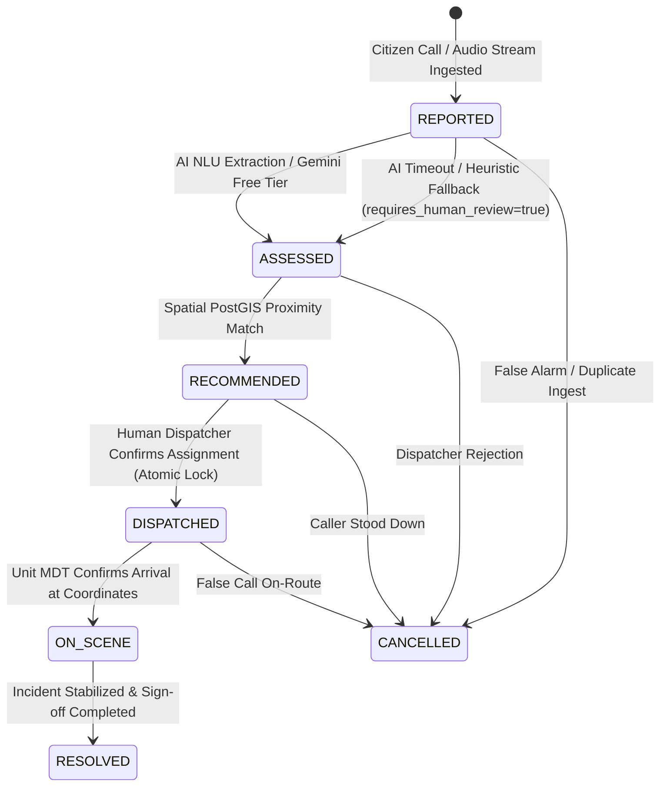

# SMART 112: Authoritative AI-Augmented Emergency Dispatch Orchestrator

[](https://github.com/smart112/smart112-orchestrator/actions/workflows/ci.yml)
[](LICENSE)
[](https://www.python.org/)
[](https://fastapi.tiangolo.com/)
[](docs/ARCHITECTURE.md)

**SMART 112** is an enterprise-grade, mission-critical public safety orchestration engine designed to modernize Public Safety Answering Points (PSAPs). Built with **zero marginal recurring software licensing cost**, sub-second fail-safe guarantees, and absolute **Backend Single Source of Truth (SSOT)** supremacy.

---

## 🏛️ System Architecture & Core Pillars

```
+-----------------------------------------------------------------------------------+
|                               SMART 112 ARCHITECTURE                              |
+-----------------------------------------------------------------------------------+
|  1. Single Source of Truth (SSOT)                                                 |
|     - All state transitions & severity logic enforced exclusively by Backend API. |
|     - Zero client-side triage or autonomous auto-dispatch.                        |
|     - Strict atomic row locking to prevent emergency unit double-booking.         |
+-----------------------------------------------------------------------------------+
|  2. Zero-Cost Infrastructure Rule                                                 |
|     - Google Gemini API free tier with non-blocking 3.0s timeout & caching.        |
|     - Local PostgreSQL + PostGIS spatial calculations (ST_Distance, ST_DWithin).   |
|     - OpenStreetMap (OSM) local/open tiles rendered via Leaflet.js engine.        |
+-----------------------------------------------------------------------------------+
|  3. Fail-Safe Resilience & Non-Blocking Fallback                                  |
|     - High-fidelity deterministic NLP rule classifier fallback upon AI timeout.  |
|     - Requires Human Review protocol whenever uncertainty signals emerge.        |
|     - Immutable, append-only chronological Audit Ledger for complete governance.  |
+-----------------------------------------------------------------------------------+
```

---

## 🚦 Incident State Machine Lifecycle



---

## 🔒 Security Hardening & AppSec Audits

1. **Secret & Key Isolation**:
   - Zero hardcoded API keys or database credentials in source tree.
   - Pydantic v2 `BaseSettings` (`backend/app/core/config.py`) loads all configuration securely from environment variables.
   - Standardized template provided via `.env.example`.
2. **API & Input Hardening**:
   - Pydantic schemas sanitize all inputs, stripping malicious HTML tags, null bytes, and script injection vectors.
   - Strict CORS policy restricting access to authorized frontend origins.
   - `/api/v1/audio/transcribe` enforces a 15 MB payload ceiling and verifies allowed audio MIME types (`audio/wav`, `audio/mpeg`, `audio/mp3`, `audio/ogg`).
3. **Immutable Audit Ledger**:
   - `AuditLog` records cannot be updated or deleted via any REST API endpoint (prohibits PUT, PATCH, DELETE operations).

---

## 🚀 Quickstart & Local Deployment

### 1. Prerequisites
- Python 3.11+
- Node.js 20+ & npm
- PostgreSQL 16 with PostGIS extension (or automatic local SQLite fallback for dev)

### 2. Configure Environment
```bash
cp .env.example .env
```

### 3. Apply Alembic Database Migrations
```bash
alembic upgrade head
```

### 4. Build Frontend Static Assets
```bash
cd frontend
npm install
npm run build
cd ..
```

### 5. Run Production Server
```bash
uvicorn backend.app.main:app --host 0.0.0.0 --port 7860
```
Open your browser to `http://localhost:7860` to access the live dispatcher console.

---

## 🧪 Verification & Automated Testing

Execute the comprehensive test suite across unit, integration, spatial PostGIS, and security hardening tests:

```bash
# Set PYTHONPATH and execute Pytest
PYTHONPATH=. pytest backend/tests/ -v
```

Execute frontend type check and production build:
```bash
cd frontend && npm run build
```

---

## 🐳 Docker & Hugging Face Spaces Deployment

The repository includes a multi-stage `Dockerfile` optimized for zero-cost deployment on Hugging Face Spaces:

```bash
# Build production Docker container
docker build -t smart112-orchestrator .

# Run container on port 7860
docker run -p 7860:7860 smart112-orchestrator
```

