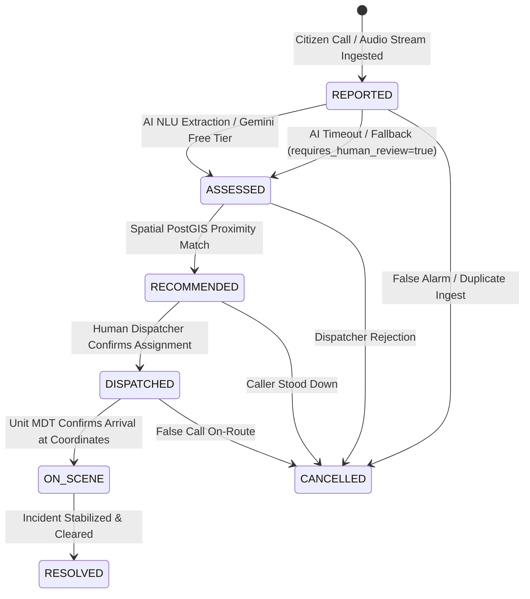
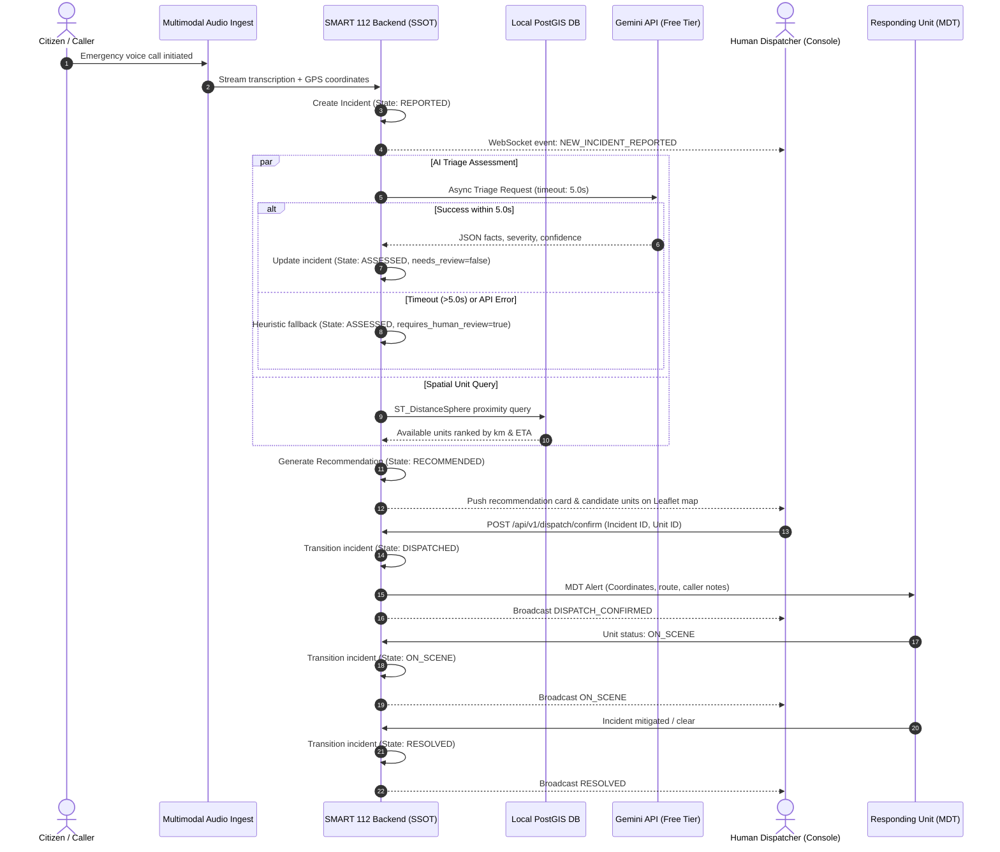

# SMART 112: Master System Architecture & State Machine Specification

## 1. System Overview
**SMART 112** is an AI-augmented emergency dispatch and triage orchestration platform designed to modernize public safety answer points (PSAPs) with zero marginal software licensing cost, ultra-low latency, and mission-critical fail-safe reliability.

The system bridges citizen emergency reporting, real-time multimodal transcription, automated semantic assessment, geospatial proximity calculation, and human-in-the-loop dispatch execution.

---

## 2. Core Architectural Pillars

```
+-----------------------------------------------------------------------------------+
|                               SMART 112 ARCHITECTURE                              |
+-----------------------------------------------------------------------------------+
|  1. Single Source of Truth (SSOT)                                                 |
|     - All state transitions & severity logic enforced exclusively by Backend API. |
|     - Zero client-side triage or autonomous auto-dispatch.                        |
+-----------------------------------------------------------------------------------+
|  2. Zero-Cost Infrastructure                                                      |
|     - Gemini Free Tier (Gemini 2.0 Flash / Gemini 1.5 Flash).                     |
|     - Local PostgreSQL + PostGIS spatial calculations.                            |
|     - OpenStreetMap (OSM) + Leaflet.js local/open client tiles.                    |
+-----------------------------------------------------------------------------------+
|  3. Fail-Safe Resilience                                                          |
|     - 5-second non-blocking AI timeouts.                                          |
|     - Automatic fallback to requires_human_review = true.                         |
|     - Preserved raw telemetry & zero dropped emergencies.                        |
+-----------------------------------------------------------------------------------+
```

---

## 3. Authoritative Incident State Machine

Every emergency incident in the SMART 112 platform progresses through a deterministic, strictly validated lifecycle. Transitions are managed exclusively by the backend state machine.



### Detailed State Transition Definitions

| State | Entry Trigger | Primary Action | Exit Condition / Validation |
| :--- | :--- | :--- | :--- |
| **`REPORTED`** | Call received, audio streaming begins, or CAD webhook payload ingested. | Coordinates recorded, `caller_text` stored, UUID minted. | Assessment pipeline invoked asynchronously. |
| **`ASSESSED`** | NLU / Gemini model returns structured evaluation OR 5s timeout triggers heuristic fallback. | Severity level assigned, `extracted_facts` stored, `uncertainty_flags` calculated. If fallback occurred, `requires_human_review=true`. | Geospatial unit matching query triggered against local PostGIS database. |
| **`RECOMMENDED`** | PostGIS completes spatial distance (`ST_DistanceSphere`) and unit capability filter. | Ranked list of `candidate_units` with ETAs and strategic `rationale` generated. Broadcast via WebSocket to Dispatcher Console. | Authenticated human dispatcher confirms, modifies, or selects candidate units. |
| **`DISPATCHED`** | Dispatcher clicks "Confirm Dispatch" or submits authorized dispatch order. | Unit status set to `EN_ROUTE`, alert pushed to unit MDT via WebSocket/radio gateway, timestamp logged. | Response unit MDT transmits geofence trigger or crew confirms arrival. |
| **`ON_SCENE`** | Unit GPS reports arrival within 100m geofence or crew toggles "On Scene". | On-scene timer starts, live status dashboard updates, auxiliary units coordinated. | Incident commander marks emergency mitigated and operational logs signed. |
| **`RESOLVED`** | Responding crew and dispatcher execute incident sign-off. | Units return to `AVAILABLE` status, incident archived, full audit trail sealed. | Lifecycle terminal state. |
| **`CANCELLED`** | Caller cancellation, duplicate incident merging, or verified hoax. | Reason code recorded, dispatched units recalled immediately. | Terminal state. |

---

## 4. End-to-End Incident Sequence Flow



---

## 5. Architectural Subsystems

### 5.1. Backend Orchestrator (`smart112-backend`)
- **Technology**: Python 3.11+, FastAPI, SQLAlchemy 2.0 (Async), Pydantic v2.
- **Responsibilities**:
  - Enforces authoritative state machine transitions.
  - Implements contract schemas from `contracts/` with zero schema deviation.
  - Hosts WebSocket gateway for sub-second updates to Dispatcher Consoles and MDTs.
  - Manages database sessions and connection pools.

### 5.2. Geospatial & Data Layer (Zero-Cost Local PostGIS)
- **Technology**: PostgreSQL 16 + PostGIS 3.4.
- **Capabilities**:
  - Geodesic spatial calculations using `ST_DistanceSphere` and spatial indexing (`GIST`).
  - Unit status and location tracking without recurring external geocoding costs.
  - Proximity radius filtering and station boundary polygon containment.

### 5.3. Multimodal & Intelligence Layer
- **Technology**: Google Gemini 2.0 Flash / 1.5 Flash (Free Tier via API key).
- **Execution Rules**:
  - Strict 5-second asynchronous timeout wrapper (`asyncio.wait_for`).
  - Structured JSON output enforcement conforming to `contracts/assessment.schema.json`.
  - Fail-safe fallback logic that flags `requires_human_review = true` upon network or API errors.

### 5.4. Dispatcher Console UI
- **Technology**: React 18 / Vite / TypeScript / Tailwind CSS / Leaflet.js.
- **Rules**:
  - Client acts purely as an interactive display and confirmation terminal.
  - No client-side severity calculation or autonomous dispatch execution.
  - Map powered by local/free OpenStreetMap tiles via Leaflet with offline-cache capability.

---

## 6. Contract Verification & Schemas

All inter-service payloads validate against formal JSON Schemas stored in the repository:
- [`incident.schema.json`](../contracts/incident.schema.json): Canonical incident payload.
- [`assessment.schema.json`](../contracts/assessment.schema.json): Structured AI triage evaluation.
- [`recommendation.schema.json`](../contracts/recommendation.schema.json): Unit pairing and tactical rationale.
- [`dispatch.schema.json`](../contracts/dispatch.schema.json): Dispatch deployment order and unit telemetry.

---

## 7. Fail-Safe & Degradation Guarantees

1. **AI Circuit Breaker**: If three consecutive calls to the Gemini API fail or exceed latency budgets, the circuit opens, directing all incoming calls through the rule-based keyword classifier and flagging `requires_human_review = true`.
2. **Offline Local Resilience**: The core dispatch loop (ingestion, PostGIS spatial query, dispatcher confirmation, MDT alert) functions fully even during total external internet outages, as OSM tiles and PostGIS operate entirely on local premises.
3. **Audit Immutability**: All state transitions, dispatcher overrides, and AI confidence scores are recorded to an append-only event log table for regulatory compliance and post-incident review.
