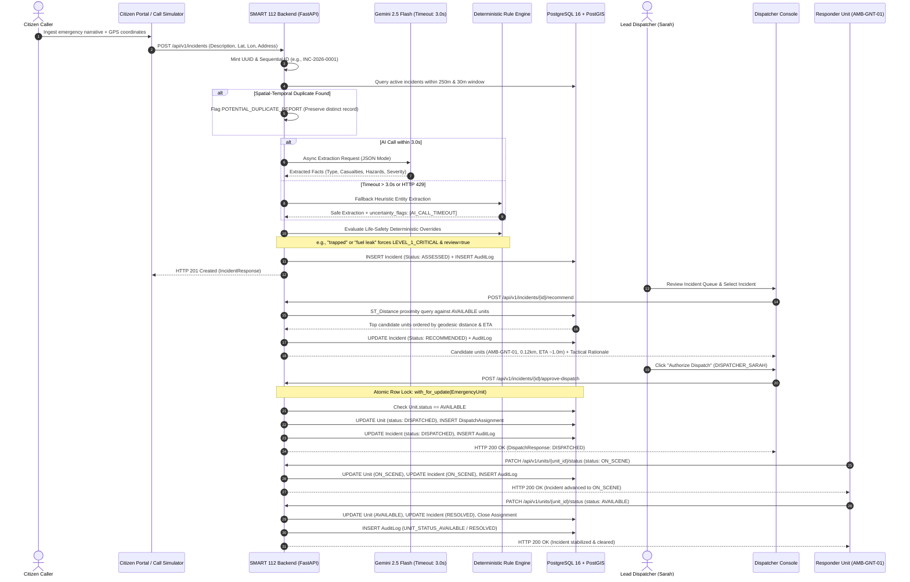

# SMART 112: System Technical Design Document (TDD)

## 1. High-Level Architecture & Conceptual Design

**SMART 112** is an AI-augmented emergency operations orchestration and decision-support engine engineered for Public Safety Answering Points (PSAPs). The platform is architected around the **Single Source of Truth (SSOT)** doctrine: client interfaces (dispatch consoles, citizen intake portals, and mobile responder terminals) are strictly non-authoritative display and confirmation terminals. All severity evaluations, lifecycle state transitions, spatial proximity queries, and dispatch actions are validated and recorded exclusively by the backend state machine.

### Core Architectural Principles
1. **Authoritative Backend State Machine**: Zero client-side triage or automated autonomous dispatch. State transitions follow strict lifecycle validation with atomic concurrency locks.
2. **Zero Marginal Infrastructure Cost**: Integrates free-tier AI models (Google Gemini 2.5/2.0 Flash) with a local PostgreSQL 16 + PostGIS 3.4 spatial database and local OpenStreetMap (OSM) Leaflet raster tiles, eliminating third-party API metering costs.
3. **Fail-Safe Deterministic Fallback**: Asynchronous 3.0-second AI timeouts guarantee non-blocking operations. When upstream models are unreachable or rate-limited, high-fidelity deterministic NLP rule classifiers immediately categorize the emergency, raising `requires_human_review = true` and logging diagnostic uncertainty flags.
4. **Immutable Governance & Traceability**: Append-only audit logging tracks all caller interactions, AI extractions, spatial recommendations, dispatcher sign-offs, and unit status transitions.

---

## 2. System Component Architecture & Flow

### Component Architecture Diagram (`flowchart LR`)

```mermaid
flowchart LR
    subgraph Clients["Presentation & Intake Layer"]
        CP["Citizen Emergency Portal<br/>(React / Leaflet)"]
        DC["Dispatcher Console<br/>(React CAD Operations)"]
        MDT["Mobile Data Terminal<br/>(Responder Vehicle Tablet)"]
    end

    subgraph Gateway["API & Ingestion Gateway"]
        FA["FastAPI Application<br/>(/api/v1)"]
        CORS["CORS & Input Sanitizer<br/>(Pydantic v2)"]
        STT["Multimodal Audio Ingest<br/>(faster-whisper)"]
    end

    subgraph CoreServices["Orchestration Core"]
        SM["Lifecycle State Machine<br/>(Valid Transitions)"]
        DS["Dispatch Service<br/>(Atomic Row Locking)"]
        MATCHER["Spatial Proximity Matcher<br/>(PostGIS ST_Distance)"]
        RULES["Deterministic Rule Engine<br/>(Keyword Escalation)"]
    end

    subgraph Intelligence["AI & Knowledge Layer"]
        GEMINI["Google Gemini API<br/>(2.5 Flash / Free Tier)"]
        FALLBACK["Fail-Safe Fallback Engine<br/>(Timeout & Uncertainty)"]
    end

    subgraph DataStore["Persistence & Cartography Layer"]
        PG[("PostgreSQL 16 + PostGIS 3.4<br/>(Spatial GIST Indexes)")]
        SQLITE[("SQLite Fallback<br/>(Dev / Embedded Mode)")]
        AUDIT[("Immutable Audit Ledger<br/>(Append-Only Events)")]
        OSM["OpenStreetMap Tiles<br/>(Raster OSM Server)"]
    end

    CP -->|POST /api/v1/incidents| FA
    CP -->|POST /api/v1/audio/transcribe| STT
    DC -->|POST /recommend| FA
    DC -->|POST /approve-dispatch| FA
    MDT -->|PATCH /units/{id}/status| FA

    FA --> CORS
    CORS --> SM
    STT --> FA

    SM --> RULES
    RULES --> GEMINI
    GEMINI -.->|Timeout >3.0s / Error| FALLBACK
    FALLBACK --> SM

    SM --> DS
    DS --> MATCHER
    MATCHER --> PG
    MATCHER -.->|Fallback| SQLITE
    DS --> AUDIT

    DC -.->|Tile Layer| OSM
    CP -.->|Tile Layer| OSM
```

---

## 3. End-to-End Emergency Lifecycle Sequence Flow

### Critical Sequence Diagram (`sequenceDiagram`)



---

## 4. Data Models, Storage & Persistence Architecture

### Database Schema Entity Relationships

```
+-----------------------------------+         +-------------------------------------+
|             incidents             |         |            emergency_units          |
+-----------------------------------+         +-------------------------------------+
| id: VARCHAR(36) [PK]              |         | id: VARCHAR(36) [PK]                |
| incident_number: VARCHAR(32) [UQ] |         | callsign: VARCHAR(32) [UQ]          |
| description: TEXT                 |         | unit_type: VARCHAR(32)              |
| category: VARCHAR(64)             |         | status: VARCHAR(32)                 |
| status: VARCHAR(32)               |         | latitude: FLOAT                     |
| severity: VARCHAR(32)             |         | longitude: FLOAT                    |
| latitude: FLOAT                   |         | geom: GEOMETRY(POINT, 4326) [GIST]  |
| longitude: FLOAT                  |         | station: VARCHAR(128)               |
| geom: GEOMETRY(POINT, 4326) [GIST]|         +-------------------------------------+
| address: VARCHAR(256)             |                            | 1
| requires_human_review: BOOLEAN    |                            |
| assessment_data: TEXT (JSON)      |                            |
| created_at: TIMESTAMPTZ           |                            |
| updated_at: TIMESTAMPTZ           |                            |
+-----------------------------------+                            |
        | 1                                                      |
        |                                                        |
        +----------------------------+                           |
        | 1                          | 1                         | N
+-----------------------+   +------------------------------------+----------+
|      audit_logs       |   |               dispatch_assignments            |
+-----------------------+   +-----------------------------------------------+
| id: VARCHAR(36) [PK]  |   | id: VARCHAR(36) [PK]                          |
| incident_id: VARCHAR  |   | incident_id: VARCHAR(36) [FK -> incidents.id] |
| actor: VARCHAR(64)    |   | unit_id: VARCHAR(36) [FK -> emergency_units]  |
| action: VARCHAR(64)   |   | dispatcher_id: VARCHAR(64)                    |
| details: TEXT (JSON)  |   | status: VARCHAR(32)                           |
| timestamp: TIMESTAMPTZ|   | notes: TEXT                                   |
+-----------------------+   | timestamp: TIMESTAMPTZ                        |
                            | on_scene_at: TIMESTAMPTZ                      |
                            | cleared_at: TIMESTAMPTZ                       |
                            +-----------------------------------------------+
```

### Storage Engines
- **Primary Production Engine**: PostgreSQL 16 with PostGIS 3.4. Spatial geometry points (`geom`) are indexed via Generalized Search Tree (`GIST`) indexes, supporting sub-millisecond geodesic calculations using `ST_Distance` and `ST_DWithin`.
- **Development & In-Memory Fallback**: Automatic detection in `core/database.py` routes to SQLite and spherical Haversine trigonometric calculations if PostgreSQL is offline, ensuring frictionless local execution.
- **Caching & Polling**: Frontend polls `/api/v1/incidents` and `/api/v1/units` on a 5-second cadence with request-in-flight guards (`requestInFlightRef`) to prevent overlapping telemetry traffic.

---

## 5. API & Interface Specifications

All request and response contracts conform strictly to schemas located in `contracts/`:

| Method | Endpoint | Description | Auth / Role | Contract Schema |
| :--- | :--- | :--- | :--- | :--- |
| **GET** | `/health` | Readiness probe; verifies PostGIS connectivity & dialect | Public | Internal probe |
| **POST** | `/api/v1/incidents` | Ingests report, executes AI triage, detects duplicates | Public / Citizen | `incident.schema.json` |
| **GET** | `/api/v1/incidents` | Retrieves active incidents sorted by severity & recency | Public / Console | `incident.schema.json` |
| **GET** | `/api/v1/incidents/{id}` | Retrieves single incident details + assigned telemetry | Public / Console | `incident.schema.json` |
| **POST** | `/api/v1/incidents/{id}/recommend` | Runs spatial proximity matching, transitions to `RECOMMENDED` | Dispatcher | `recommendation.schema.json` |
| **POST** | `/api/v1/incidents/{id}/approve-dispatch` | Authorizes unit dispatch with atomic row lock | Verified Dispatcher | `dispatch.schema.json` |
| **GET** | `/api/v1/units` | Fleet monitor listing all unit positions and readiness | Dispatcher / MDT | Internal list |
| **PATCH** | `/api/v1/units/{id}/status` | Updates unit status (`ON_SCENE`, `AVAILABLE`); cascades incident | Responder MDT | `dispatch.schema.json` |
| **GET** | `/api/v1/audit/{incident_id}` | Fetches chronological immutable audit records | Governance / Auditor | `AuditRecord` |
| **POST** | `/api/v1/audio/transcribe` | Audio file ingestion (.wav, .mp3) with Whisper STT | Public / Call Ingest | Multipart audio |
| **DELETE**| `/api/v1/incidents/purge-all` | Development reset utility (refused in production) | Operator / Test | Internal reset |

---

## 6. Security, Reliability & Failure Modes

### 1. Concurrency Control & Double-Booking Prevention
When a dispatcher clicks "Confirm Dispatch", the backend acquires an exclusive row-level lock:
```python
unit = db.query(EmergencyUnit).filter(EmergencyUnit.id == unit_id).with_for_update().first()
```
If two dispatchers simultaneously assign the same ambulance to different incidents, the first transaction commits while the second encounters a verified `unit.status != 'AVAILABLE'` condition and is aborted with **HTTP 409 Conflict**. Lock acquisition strictly follows a hierarchical order (`EmergencyUnit` -> `DispatchAssignment` -> `Incident`) across all endpoints to guarantee mathematical deadlock prevention.

### 2. Authorization & Dispatcher Verification
All state-modifying dispatch endpoints enforce actor validation. Dispatcher IDs are normalized, stripped of non-alphanumeric characters, and validated against authorized operational roles. Unverified IDs are rejected with **HTTP 403 Forbidden**.

### 3. Fail-Safe AI Degradation Matrix
| Failure Mode | Impact | Automated System Mitigation |
| :--- | :--- | :--- |
| **AI API Timeout (>3.0s)** | Gemini call exceeds latency threshold | Non-blocking cancellation; heuristic rule extraction executed; `requires_human_review = True`; `uncertainty_flags: ["AI_CALL_TIMEOUT"]`. |
| **Upstream HTTP 429 Rate Limit** | Gemini free-tier rate ceiling hit | Fallback to deterministic NLP parser; incident persists without caller data loss. |
| **Schema Deviation / Nulls** | Model outputs invalid JSON | Synthesizes fallback payload; raw transcript preserved verbatim; flagged for dispatcher review. |
| **GIS Tile Server Outage** | OSM tile provider unreachable | Tile error event logged; user alerted via in-map banner; tabular triage queue and straight-line coordinates remain operational. |
| **Database Network Disconnect** | Primary PostGIS database drops | `/health` reports 503 degraded; requests fail cleanly without corrupting memory state. |
